<div align="center">

# CardioVision

**Coronary artery disease risk, artery by artery, on an interactive 3D heart**

Multimodal AI Hackathon 2026 · Track A: Cardiovascular Risk Visualization & Prediction

Team HumanSlop: **Varun Rao** and **Galaba Vamsi**


-0.94-2563eb?style=flat-square)


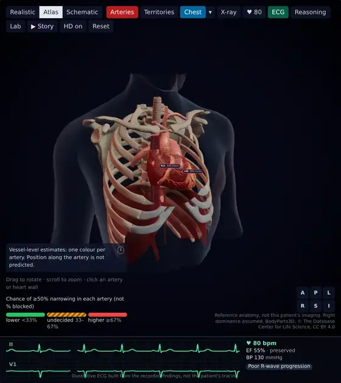

<sub>The atlas heart in the chest: the camera flies in, the heart beats at this patient's recorded pulse, and each artery carries its own model's estimate.</sub>

**[▶ Watch the demo video (7 min)](https://youtu.be/Gk6_mYgvZAc)** ·
**[Technical documentation (PDF, 6 pages)](docs/CardioVision-Technical-Documentation.pdf)** ·
[Model verification](docs/model-verification.md) ·
[Model report](docs/model-report.md) ·
[Demo video script](docs/demo-script.md) ·
[Devpost text](docs/devpost.md)

</div>

CardioVision estimates the chance of **coronary artery disease (CAD)** and of **≥50% narrowing in each main coronary
artery (LAD, LCX, RCA)** from 55 routine findings: demographics, history, symptoms, examination, ECG, laboratory tests
and echo. Every estimate is shown on an interactive 3D heart and explained exactly. An interactive layer makes the
numbers tangible: the heart beats with the patient's recorded pulse, ejection fraction and blood pressure; the
evidence flows into it by data type; a what-if card shows what moves each estimate; a teaching lab shows what a
narrowed artery does to blood flow; the most similar real patients appear with their angiograms; and one button plays
a captioned tour of it all.

> [!WARNING]
> **Decision support and education only.** The models were trained on 303 patients referred for angiography at a
> single centre (71% had CAD) and are not validated for screening. CardioVision is not a diagnosis and does not
> replace angiography, formal diagnostic imaging or clinical judgement.

## Contents

- [At a glance](#at-a-glance)
- [Feature tour](#feature-tour)
- [Results](#results)
- [How it works](#how-it-works)
- [Run it locally](#run-it-locally)
- [Deep links](#deep-links)
- [Project structure](#project-structure)
- [Honesty by design](#honesty-by-design)
- [Judging criteria](#judging-criteria)
- [Credits and data](#credits-and-data)

## At a glance

- **Predicts** overall CAD and ≥50% stenosis of the LAD, LCX and RCA, each with its own model.
- **From** 55 clinical inputs (19 in quick mode); anything not recorded is filled in openly and listed with the result.
- **Validated**: cross-validated ROC-AUC CAD 0.94, LAD 0.86, LCX 0.76, RCA 0.74 (5×5 repeated CV, 303 patients),
  re-verified independently.
- **Explains** with exact per-input attributions that add up to each model's log-odds, plain-language drivers and
  evidence by data type.
- **Shows** three 3D hearts with one colour per artery, perfusion territories, an AHA 17-segment bullseye and a vessel
  inspector.
- **Simulates** a function twin with ECG, what-if sensitivity, an ischaemia teaching lab, similar patients and a guided
  story.
- **Runs** on FastAPI (about 140 ms per explained estimate on a laptop CPU) and React with Three.js; no dedicated GPU
  needed.

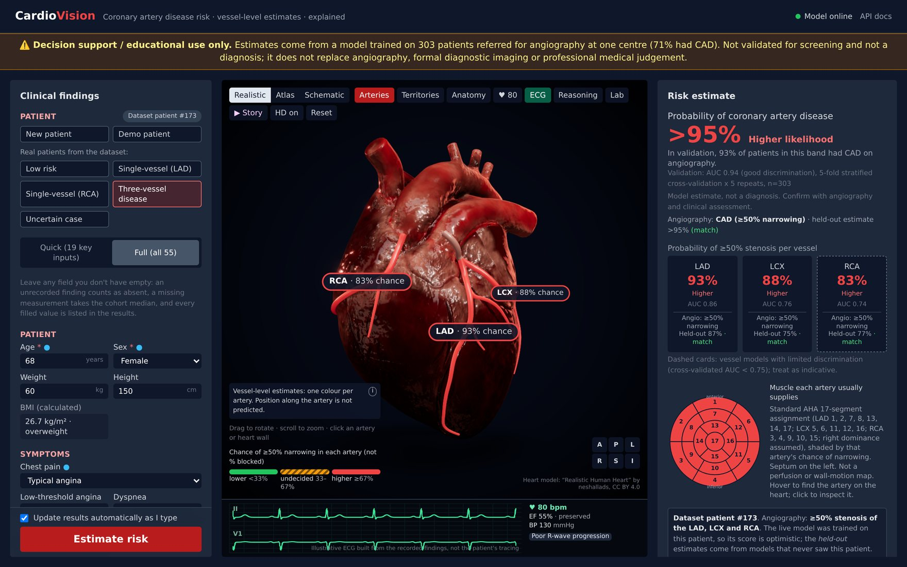

<sub>Dataset patient #173 (three-vessel disease on angiography): clinical form, 3D heart and ECG, risk panel.</sub>

## Feature tour

Every view also opens from a URL: append the link shown under each feature to `http://localhost:5173/`
(see [Deep links](#deep-links)). The clips are real captures of the running app, recorded frame by frame.

### Three hearts, one colour per artery

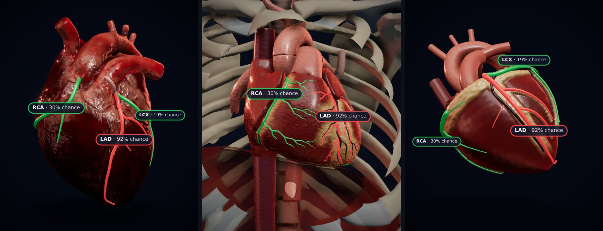

Each artery takes its colour from exactly one model's estimate: green below 33%, striped amber for the undecided band,
red from 67%. Position along the artery is never predicted.

- **Realistic** (default): a sculpted, textured heart with our own coronary tree traced on its grooves and snapped to
  the surface at load time.
- **Atlas in the chest**: built from **BodyParts3D**, the anatomy database named in the brief. 59 named coronary
  branches (with FMA ids) each take their colour from one model; the camera flies in through a ghosted chest with a
  cutaway, and X-ray mode shows the vessels on the back of the heart.
- **Schematic**: procedural, no external assets; also the automatic fallback.

`?patient=lad&heart=atlas`

<table>
<tr>
<td width="50%">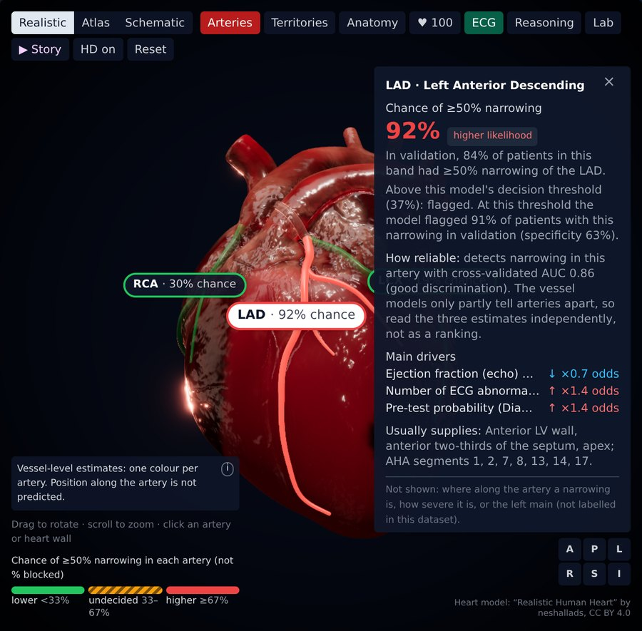</td>
<td width="50%">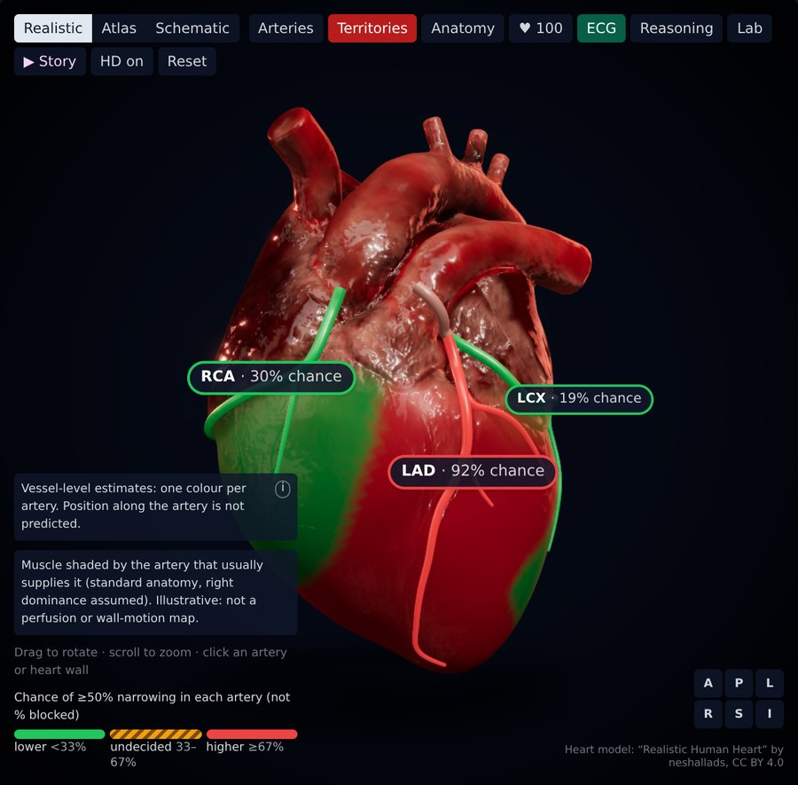</td>
</tr>
<tr>
<td><b>Click an artery or a region of heart wall:</b> the camera turns to its territory and the inspector shows the band,
the rate observed in validation, the decision threshold with its sensitivity and specificity, the model's AUC, the
main drivers and the AHA segments.<br><code>?patient=lad&amp;model=lad</code></td>
<td><b>Territories view:</b> the muscle each artery usually supplies, shaded by that artery's estimate (standard
anatomy, right dominance assumed). Illustrative: not a perfusion or wall-motion map.<br><code>?patient=lad</code>, then <b>Territories</b></td>
</tr>
</table>

### Risk panel and explanations

<table>
<tr>
<td width="50%">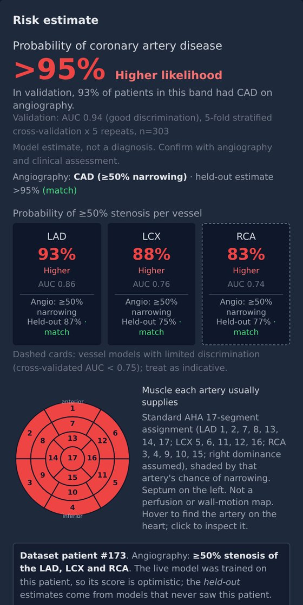</td>
<td width="50%">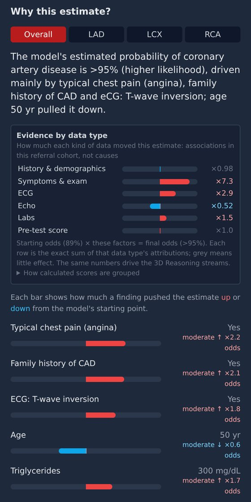</td>
</tr>
<tr>
<td><b>Risk panel:</b> whole-percent probabilities, risk bands with the rate actually observed in validation, each
model's cross-validated AUC (weaker vessel models marked), the held-out estimate against angiography for dataset
patients, and the bullseye, linked to the 3D heart.</td>
<td><b>Why this estimate:</b> a summary sentence, evidence by data type and each finding's push up or down in odds.
The attributions are exact (linear terms plus TreeSHAP) and add up to the model's log-odds, checked on every
request.</td>
</tr>
</table>

### The function twin

<table>
<tr>
<td width="50%">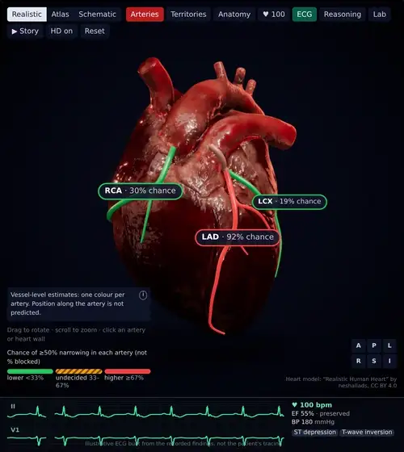</td>
<td>

The heart beats at the patient's **recorded pulse**: the ejection fraction sets the squeeze, systolic BP the aortic
pulse, and a left bundle branch block delays the lateral wall. A two-lead **illustrative ECG** (II, V1), in step with
the beat, is built from the recorded findings: here ST depression and T-wave inversion at 100 bpm. Values that were
not entered are labelled as typical. All three hearts.

`?patient=lad`

</td>
</tr>
</table>

### What moved the estimate

<table>
<tr>
<td width="50%">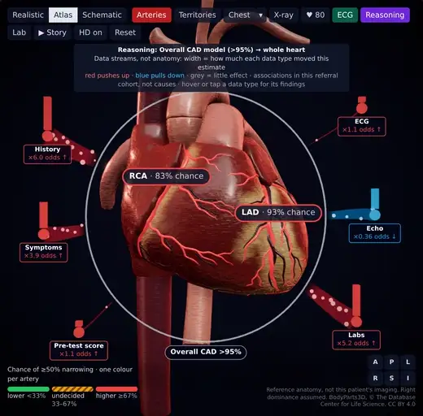</td>
<td>

Each model's exact attributions, **summed by data type** (history and demographics, symptoms and exam, ECG, echo,
labs, pre-test score), stream from towers around the heart into a halo round the whole heart for overall CAD, or into
the selected artery (here the LAD, after a click). Width shows how much each data type moved the estimate; red pushes
it up, blue pulls it down. These are associations in a referral cohort, not causes.

`?patient=triple&heart=atlas&reasoning=1`

</td>
</tr>
</table>

### What-if

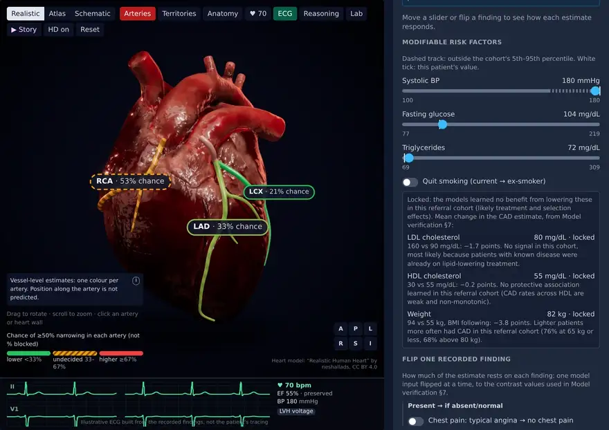

Sliders for systolic BP, fasting glucose and triglycerides, a quit-smoking switch and "flip one recorded finding"
switches re-run the models live while you drag, and a delta strip shows each change. Above, systolic BP goes from 180
to 120 mmHg and typical angina is switched to no chest pain: the overall CAD estimate falls from 90% to 30%. This is
**model sensitivity, not the effect of treatment**: the form is never edited, Reset returns to the patient exactly,
and LDL, HDL and weight are locked because the models learned no benefit from them in this cohort
([verification §7](docs/model-verification.md)).

`?patient=rca&whatif=1&contrast=angina`

### Ischaemia lab (teaching sandbox)

<table>
<tr>
<td width="50%">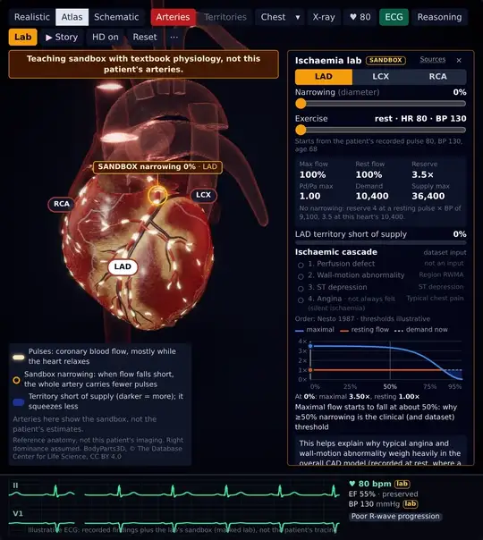</td>
<td>

Drag a **generic narrowing** (0–95%) and the exercise level (rest to peak) on the atlas heart. Flow pulses, mostly in
diastole, thin past the SANDBOX marker; the territory turns ischaemic and contracts less; the **ischaemic cascade**
lights up in order beside the dataset inputs it corresponds to; and the flow-reserve curve shows why ≥50% is the
clinical threshold.

Textbook coronary physiology (Gould's pressure-flow relation, Nesto's cascade), unit-tested against the published
curve and starting from the patient's recorded pulse, BP and age. Always labelled a sandbox, never the patient's
lesion.

`?patient=triple&lab=lad&narrowing=90&exercise=1`

</td>
</tr>
</table>

### Similar patients

<table>
<tr>
<td width="45%">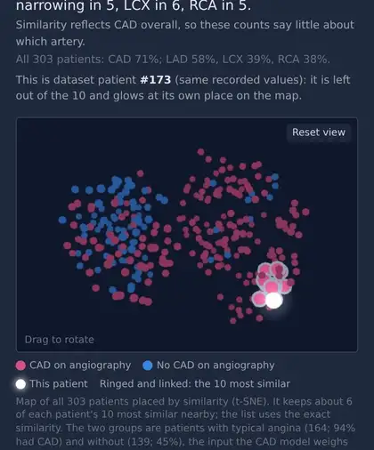</td>
<td>

The **10 most similar of the 303 real patients**, found in the browser (inputs weighted by what the CAD model uses,
inputs not entered left out), with their held-out estimates against their angiograms. The 3D t-SNE map places every
patient by similarity, coloured by outcome; its two clusters are patients with and without typical angina.

`?patient=triple&cohort=1`

</td>
</tr>
</table>

### Story mode

<table>
<tr>
<td width="50%">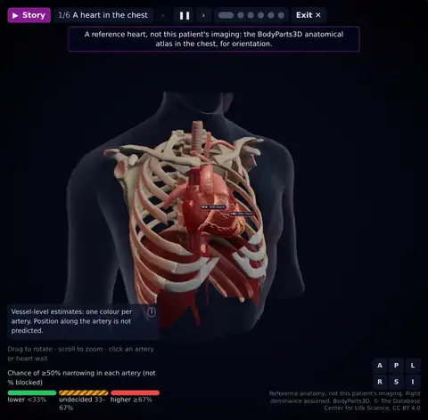</td>
<td>

One button plays a **92-second captioned tour** of the current patient on the atlas heart: the chest fly-in, the
function twin, the reasoning streams, the artery in the highest band with its inspector ("independent estimates, not
a culprit ranking"), the lab demonstrating a narrowing and exercise, and a closing card on what this is and is not,
with each model's AUC and confidence interval.

Play/pause, step dots, arrow keys and Esc; exit gives back your exact view; reduced motion gives static steps. The
clip skips through the steps and plays the lab at 4× speed.

`?patient=triple&story=1`

</td>
</tr>
</table>

<details>
<summary><b>Full feature list</b></summary>

- **Validated models**: per target, an equal-weight log-odds blend of a regularised logistic regression on clinical
  composites (Diamond-Forrester pre-test probability, risk-factor and ECG-abnormality counts, lipid ratios, eGFR, ...)
  and a shallow gradient-boosted tree model, chosen from six strategies by a leakage-safe 5×5 repeated-CV protocol
  with adversarial re-verification on unseen splits (`backend/experiments/`). Decision thresholds and calibration are
  learned inside training folds only.
- **Usable clinical form**: quick mode (19 key inputs) or full mode (55); units, ranges and typical values inline;
  chest pain and smoking as single choices; BMI calculated; validation as you type; any field can be left empty
  (unrecorded findings count as absent, measurements take the cohort median) and the result lists what was filled in;
  out-of-range values are flagged.
- **Live results**: estimates update as you type, stale results are clearly marked, and API errors are shown in place
  (field-level validation, offline or untrained-model messages, status indicator).
- **Honest results display**: whole-percent probabilities, risk bands with the event rate observed in validation,
  each model's cross-validated AUC, weaker vessel models marked, disagreement between the CAD and vessel models
  flagged, and the safety disclaimer always visible and included in every API response.
- **Realistic 3D heart**: the LAD, diagonals, LCX, obtuse marginals, RCA, RV branch and PDA were traced on the model's
  sculpted grooves; at load time each path is snapped onto the surface (BVH closest point), lifted along the normal
  and smoothed. Perfusion territories are computed per vertex from the nearest artery tree and masked to the
  ventricles; clicking the wall, camera focus, labels, anatomy pins and the heartbeat all work on this model.
- **Atlas 3D heart in the chest**: every coronary branch is a named BodyParts3D structure (LAD trunk, diagonals,
  septals, conus and right anterior branches; circumflex; RCA trunk, conus, marginal, ventricular and posterior
  branches, PDA and its septals; left main, neutral because the dataset does not label it). Clicking a branch names it
  ("Diagonal branch of anterior descending branch of left coronary artery, FMA3860 → LAD → coloured by the LAD
  model"). The ghosted chest (skin, ribs, costal cartilage, sternum, spine, clavicles, scapulae, diaphragm, trachea)
  has a camera-facing cutaway; A/P/L/R/S/I buttons snap to the standard views. Both GLBs together are under 0.8 MB;
  rebuild them from the official archive with `npm run assets:bp3d` (fetches only the 181 listed meshes over HTTP
  Range, CRC-checked).
- **Schematic 3D heart**: ventricles, atrial appendages, aortic arch with its branches, pulmonary trunk, venae cavae
  and pulmonary veins; coronary arteries in their real grooves, tapering, half-embedded in epicardial fat and paired
  with the cardiac veins.
- **Realistic rendering**: wet-tissue physical materials, a procedural muscle-fibre normal map, studio lighting built
  from light-formers, a contact shadow and an "HD" pass (ambient occlusion, bloom on the selected vessel, ACES tone
  mapping, vignette) that switches itself off on slow GPUs.
- **One band colour scale** across the 3D arteries, cards and legend; the last estimate stays on screen while you
  type, so the arteries never flash grey.
- **AHA 17-segment bullseye** linked to the 3D heart: hover a segment to find its artery, click to inspect it.
- **Plain-language explanations per model**: a summary sentence, top drivers with odds multipliers, derived clinical
  scores labelled with their inputs, a waterfall in percentage points and a physiological breakdown of all 55
  measurements by body system.
- **Example patients**: five real dataset patients (normal, LAD, RCA, three-vessel and an honest uncertain case),
  shown with their angiography result and the *held-out* estimate from models that never saw them, false alarms
  included.
- **Anatomy pins** (realistic and schematic hearts): numbered annotations with short clinical notes.

</details>

## Results

5×5 repeated stratified cross-validation on all 303 patients (`backend/models/metrics.json`, regenerated by
`train.py`):

| Target | ROC-AUC | 95% CI (bootstrap) | PR-AUC | Brier | Accuracy | Precision | Recall | F1 |
|---|---|---|---|---|---|---|---|---|
| CAD | **0.943** ± 0.005 | 0.91–0.97 | 0.976 | 0.083 | 0.883 | 0.910 | 0.928 | 0.919 |
| LAD | **0.856** ± 0.011 | 0.82–0.91 | 0.883 | 0.148 | 0.799 | 0.797 | 0.880 | 0.836 |
| LCX | **0.761** ± 0.013 | 0.71–0.81 | 0.625 | 0.196 | 0.700 | 0.656 | 0.497 | 0.566 |
| RCA | **0.739** ± 0.006 | 0.70–0.81 | 0.594 | 0.199 | 0.682 | 0.596 | 0.479 | 0.530 |

± is the spread across the 5 CV repeats (split noise), not a confidence interval. Decisions at 0.5 shown; the app
uses the F1-optimal threshold learned in training (nested estimates: LCX F1 0.66, RCA F1 0.61, CAD rule-out
sensitivity 0.97 with NPV 0.89). The previous XGBoost model scored AUC 0.90 / 0.83 / 0.75 / 0.68 under the same
protocol.


**Independently verified** (`backend/verify_models.py` → [`docs/model-verification.md`](docs/model-verification.md)):

- **No target leakage**: the full recipe trained on shuffled labels scores AUC 0.48–0.52.
- **Fresh splits**: on split seeds never used in development it gives AUC 0.939 / 0.859 / 0.745 / 0.754
  (CAD / LAD / LCX / RCA), so LCX and RCA move about ±0.02 between split sets.
- **Baselines**: it beats plain logistic regression, default XGBoost and the Diamond-Forrester score alone on the same
  folds.
- **Calibration** slopes 0.85–1.11; the served models equal a fresh refit, and the API returns exactly their
  predictions.
- **Two honest limits**: the vessel models mostly measure how much CAD there is, not which artery (within CAD
  patients their AUC falls to 0.62–0.69), and LDL and HDL carry no protective signal in this referral cohort (so the
  what-if card locks LDL, HDL and weight). Expect the true AUCs to be about 0.005–0.01 lower than shown (0.01–0.02
  for RCA), because the recipe was chosen on these 303 patients.

## How it works


- **Data**: the UCI *Extension of Z-Alizadeh Sani* dataset (303 patients, 55 features: demographics, vitals, history,
  symptoms, ECG, labs, echo). The `LAD`, `LCX`, `RCA` and `Cath` columns are never model inputs.
- **Models** (`backend/app/cardio_models.py`): one log-odds blend per target, a regularised logistic regression on
  clinical composites plus shallow boosted trees (LightGBM or XGBoost), with thresholds, calibration and risk bands
  learned inside training folds.
- **Explanations**: linear terms plus native TreeSHAP; base plus attributions equals the model's log-odds, checked on
  every request.
- **API** (FastAPI): `POST /explain` returns probabilities, thresholds, bands, warnings, filled-in fields and
  attributions (median about 140 ms); `POST /predict` skips attributions (about 40 ms) and serves the what-if sliders
  while dragging; `GET /metrics`, `/features`, `/health`. Every response carries the safety disclaimer.
- **Frontend**: React 18, TypeScript, Vite, Tailwind and React Three Fiber. One artery registry
  (`frontend/src/anatomy/registry.ts`) drives the colours, territories, AHA segments, inspector, lab and story, with
  no hard-coded artery lists elsewhere.
- **Generated data**: `make_presets.py` picks the example patients from held-out predictions and `make_cohort.py`
  builds the similarity space and 3D map; both are deterministic.

<details>
<summary><b>3D performance without a dedicated GPU</b></summary>

Full-frame render time (scene plus post-processing), measured on a laptop's integrated GPU (Intel Alder Lake GT2,
Mesa, Chrome) with the 3D panel at 676×757 px, device pixel ratio 1. Frames were timed synchronously (render, then a
1-pixel GPU read-back), median and range over repeated runs:

| Heart model | HD on (AO, bloom, vignette) | HD off |
|---|---|---|
| Realistic (Sketchfab, textured) | 11 ms | 6 ms |
| Atlas (BodyParts3D heart) | 14 ms (12–17) | 11 ms (4–11) |
| Atlas in the chest (heart + 74k-triangle chest) | 12 ms (10–18) | 9 ms (7–9) |
| Schematic (procedural) | 14 ms | 11 ms |

Every configuration stays under 18 ms per frame (above 55 fps). The device pixel ratio is capped at 1.5, contact
shadows are rendered once per model, and HD switches itself off if the frame rate stays below about 24 fps. Asset
sizes: realistic heart 1.6 MB, atlas heart 0.39 MB, chest 0.35 MB. The table was measured before the twin layers
were added; they allocate nothing per frame and use instanced particles, but have not yet been re-timed on the
integrated GPU.

</details>

## Run it locally

**Prerequisites:** Python 3.10–3.13 and Node 18+. The dataset (`backend/data/extention.zip`, the UCI download) and
the four trained models (`backend/models/*.joblib`, 2 MB) ship with the repository, so nothing has to be trained
first; `python train.py` rebuilds the models from the data in about 5 minutes.

**Backend**

```bash
cd backend
python -m venv .venv && source .venv/bin/activate
pip install -r requirements.txt
uvicorn app.main:app --reload --port 8000   # the trained models ship in backend/models/
```

API docs at http://localhost:8000/docs.

**Frontend** (in a second terminal)

```bash
cd frontend
npm install
npm run dev                          # http://localhost:5173 (proxies API calls to :8000)
```

<details>
<summary><b>Optional scripts, tests and troubleshooting</b></summary>

```bash
# backend/
python train.py            # retrain the four models (about 5 min; numerically identical to the shipped ones)
python make_presets.py     # regenerate the example patients (frontend/src/presets.json)
python make_cohort.py      # regenerate "Similar patients" (frontend/src/cohort/cohort.json); re-run after any retrain
python test_pipeline.py    # end-to-end sanity check, no server needed
python verify_models.py    # independent model verification, a few minutes (writes docs/model-verification.md)

# frontend/
npm test                   # vitest: twin, coronary physiology, lab, reasoning groups, what-if, cohort kNN, story
npm run build
```

To point a production build at another API host, set `VITE_API_URL` at build time (CORS is enabled).

- **"API offline"** in the header: start the backend (`uvicorn app.main:app --port 8000`), then click *retry*.
- **"Models not trained"**: run `python train.py` in `backend/`.
- **Slow or blank 3D view**: switch *HD* off in the 3D toolbar; without WebGL the app shows a 2D fallback and
  everything else keeps working.

</details>

## Deep links

Append to `http://localhost:5173/`. Parameters combine, for example `?patient=triple&heart=atlas&reasoning=1`.

| View | Parameters |
|---|---|
| A dataset patient | `?patient=low`, `lad`, `rca`, `triple` or `uncertain` |
| Heart model | `heart=realistic`, `atlas` or `schematic` |
| Inspect an artery | `model=lad`, `lcx` or `rca` |
| Reasoning flow | `reasoning=1` (with `model=` for one artery) |
| What-if | `whatif=1`, with `bp=`, `fbs=`, `tg=`, `quit=1`, `contrast=angina,st,rwma,ef` |
| Ischaemia lab | `lab=lad` (or `lcx`, `rca`), `narrowing=0..95`, `exercise=0..1` |
| Similar patients | `cohort=1` |
| Story mode | `story=1`; `step=1..6` shows that step as it ends, paused; `play=1` plays from there |

## Project structure

<details>
<summary><b>Show the tree</b></summary>

```
backend/
  app/
    main.py            # FastAPI app: /predict, /explain, /metrics, /features, /health
    cardio_models.py   # production models, clinical feature engineering, exact attributions
    model.py           # model loading + inference (thresholds, risk bands)
    shap_explainer.py  # per-feature attributions for the API (additivity checked)
    schemas.py         # pydantic request/response models, validation, imputation contract
    encoders.py        # categorical encoding
    config.py          # shared paths/constants
  train.py             # training: 5x5 CV metrics, thresholds, calibration bands, feature info
  make_presets.py      # picks real example patients from held-out predictions
  make_cohort.py       # similarity space + 3D t-SNE map of the 303 patients -> frontend/src/cohort/cohort.json
  verify_models.py     # independent verification -> docs/model-verification.md, models/verification.json
  test_pipeline.py     # in-process end-to-end test
  experiments/         # leakage-safe harness + the model-selection experiments
  requirements.txt     # runtime; requirements-dev.txt adds experiment-only packages
  data/                # UCI zip (committed); extracted CSV (gitignored)
  models/              # trained models (*.joblib), held-out predictions, metrics, features, encoding, verification
frontend/
  public/models/       # heart.glb (Realistic), bp3d_heart.glb + bp3d_thorax.glb (Atlas), ATTRIBUTION.md
  scripts/             # build-bp3d.mjs (Atlas GLBs), compress-heart.mjs
  src/
    App.tsx
    anatomy/registry.ts    # one artery registry (VESSELS, territories, AHA segments) drives every view
    components/
      HeartScene.tsx       # R3F scene: heart toggle/fallback, toolbar, lighting, post-processing, selection,
                           #   camera, measured overlay layout, story playback, schematic heart
      SpecimenHeart.tsx    # realistic heart: territories overlay, vessels, pins, heartbeat
      specimenAnatomy.ts   # coronary tree traced on the model, surface snapping, territories, views
      AtlasHeart.tsx       # BodyParts3D heart + chest: named branches, X-ray, lab pulses and marker
      atlasAnatomy.ts      # atlas geometry, territories, views, distance from the ostium (lab)
      atlasMaterials.ts    # shader patches: tissue bump, chest cutaway, stripes, flow pulses, hypokinesis
      heartAnatomy.ts      # procedural (schematic) heart, fat, arteries/veins, territories, normal maps
      ArteryTube.tsx       # risk-coloured, clickable vessel tube with label (shared material)
      VesselInspector.tsx  # one artery's estimate, reliability, drivers and territory
      Bullseye.tsx         # AHA 17-segment map linked to the 3D heart
      ClinicalDashboard.tsx # risk bands, validation AUC, held-out vs angiography, notices
      WhatIfPanel.tsx      # what-if card: sliders, locked inputs, finding switches, delta strip
      FeatureInput.tsx     # clinical form: quick/full mode, validation, example patients
      ExplanationPanel.tsx # plain-language per-model explanations
      ErrorBoundary.tsx    # keeps the app usable if a panel (e.g. WebGL) fails
    twin/                  # function twin: heart clock, beat timing, mechanics, ECG (twin.ts, EcgMonitor.tsx,
                           #   useHeartMotion.ts) and the lab's coronary physiology (coronaryPhysiology.ts)
    reasoning/             # data-type groups (dataGroups.ts), 3D streams (ReasoningFlow.tsx), anchors,
                           #   "Evidence by data type" strip
    lab/                   # ischaemia lab panel, flow-reserve curve, lab settings and deep link
    whatif/                # scenario logic (scenario.ts), API wiring (useScenario.ts), strip above the 3D view
    cohort/                # cohort.json (generated), kNN (knn.ts), Similar patients card, 3D cohort map
    story/                 # story mode: the six steps and captions (storySteps.ts), controls and closing
                           #   card (StoryOverlay.tsx), step clock, AUC CIs copied from verification.json
    fieldSpec.ts           # single source for form fields, units, ranges, payload/validation
    featureLabels.ts       # clinical labels for model features and derived scores
    risk.ts                # probability / band / reliability formatting, band colours
    presets.json           # generated by backend/make_presets.py
    api/client.ts
docs/                      # technical documentation (PDF + source), model report and verification, demo script,
                           #   Devpost text, figures/ (documentation figures), media/ (README screenshots and clips)
scripts/bp3d/              # BodyParts3D part list and range fetcher (npm run assets:bp3d)
```

</details>

## Honesty by design

Each layer says what it is, in the app and in this README:

- **Vessel-level estimates only**: one colour per artery; where along the artery a narrowing sits is never predicted,
  and the three artery estimates are independent, not a culprit ranking.
- **Reference anatomy**: the 3D hearts are reference models, not the patient's imaging; findings are model inputs,
  never places on the heart.
- **Associations, not causes**: attributions and similar patients come from a single-centre referral cohort.
- **Sensitivity, not treatment**: the what-if card shows how the models respond, not what a treatment would do.
- **A labelled sandbox**: the ischaemia lab is textbook physiology on a generic narrowing, never the patient's lesion.
- **Recorded values**: the function twin uses the patient's recorded values; the ECG trace is illustrative.

## Judging criteria

| Criterion | Weight | Where to look |
|---|---|---|
| Predictive performance | 30% | ROC-AUC, accuracy, precision, recall and F1 for CAD and each artery under 5×5 repeated CV; independent verification (no leakage, fresh splits, bootstrap CIs, baselines) |
| 3D visualization | 25% | Three hearts (realistic, BodyParts3D atlas in the chest, schematic), artery colours, territories, inspector, bullseye; function twin with ECG, reasoning streams, ischaemia lab, 3D cohort map, story mode |
| Clinical interpretability | 20% | Exact attributions, plain-language panel, physiological breakdown, evidence by data type, what-if sensitivity, the ischaemic cascade, similar patients with their angiograms |
| System integration | 15% | Data pipeline, model to dashboard to 3D, live updates, what-if re-runs while dragging |
| Technical implementation | 10% | Architecture, reproducibility (deterministic generators, pinned dependencies), 111 unit tests plus the pipeline test, public datasets and meshes |

## Credits and data

- **Team HumanSlop**: Varun Rao and Galaba Vamsi.
- **Dataset**: Z-Alizadeh Sani et al., *Extension of Z-Alizadeh Sani Dataset*, UCI Machine Learning Repository (also
  on Kaggle): 303 patients; targets overall CAD and LAD, LCX and RCA stenosis.
- **3D heart model**: ["Realistic Human Heart"](https://sketchfab.com/3d-models/realistic-human-heart-3f8072336ce94d18b3d0d055a1ece089)
  by **neshallads**, licensed under [CC BY 4.0](https://creativecommons.org/licenses/by/4.0/)
  (`frontend/public/models/heart.glb`; geometry unmodified, textures re-encoded as WebP to cut the file from 7.55 to
  1.6 MB; attribution also shown in the app).
- **Atlas heart and chest**: **BodyParts3D, © The Database Center for Life Science licensed under CC Attribution 4.0
  International** ([licence](https://dbarchive.biosciencedbc.jp/en/bodyparts3d/lic.html)); the derived files
  `frontend/public/models/bp3d_*.glb` are distributed under CC BY-SA 4.0. Changes and sources:
  [`frontend/public/models/ATTRIBUTION.md`](frontend/public/models/ATTRIBUTION.md).
- **Ischaemia lab physiology**: published models and values, cited in `frontend/src/twin/coronaryPhysiology.ts` and
  in the lab's Sources list (Gould 1974 and 1980, Pijls 1993, Uren 1994, Dodge 1992, Gobel 1978, Nesto & Kowalchuk
  1987, Gallagher 1984, Seligman 2022, ACC/AHA 2002, Fletcher 2013).
- **README media**: screenshots and clips captured from the running app (headless Chrome on a laptop GPU, frame by
  frame), stored in `docs/media/`.
