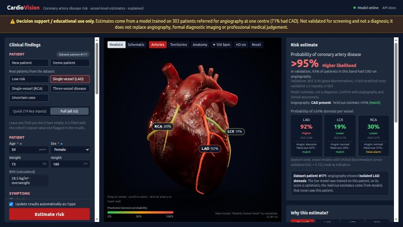
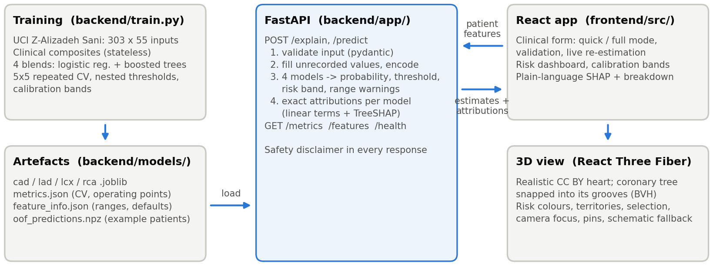
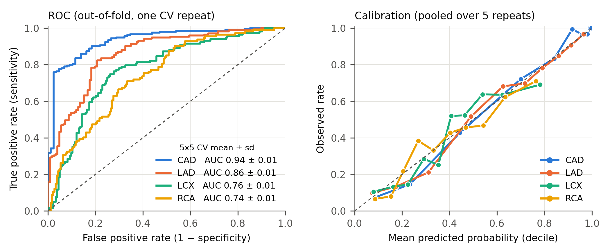
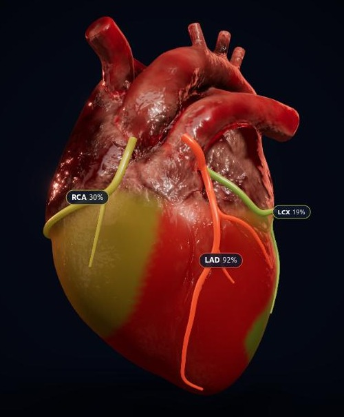
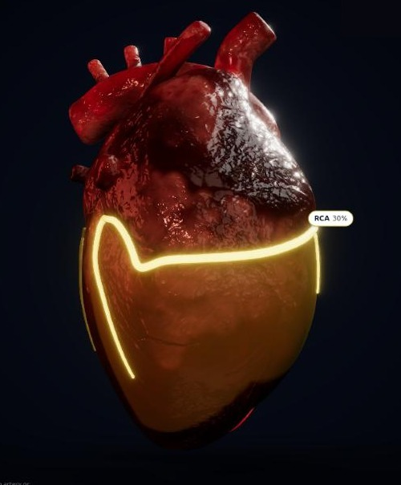
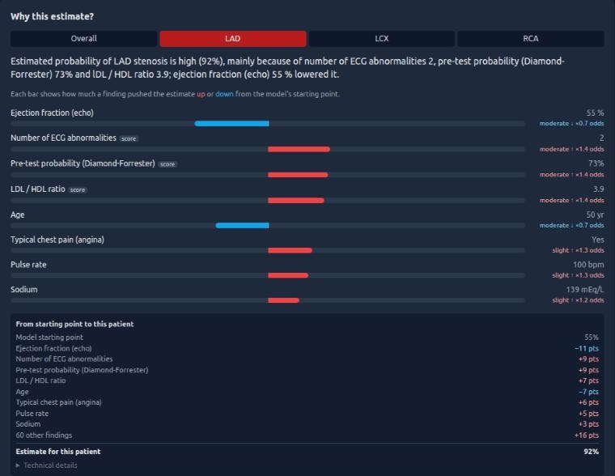

<p class="meta">Code, data pipeline and trained-model recipe: <a href="https://github.com/VARUN3WARE/cardiovision">github.com/VARUN3WARE/cardiovision</a> · All metrics are reproducible with <code>python backend/train.py</code>.</p>

<p class="warn"><b>Decision support / educational use only.</b> The models were trained on 303 patients referred for angiography at one centre (71% had CAD). They are not validated for screening, are not a diagnosis, and do not replace angiography or professional judgement. The same disclaimer is permanently visible in the UI and returned in every API response.</p>

## 1. Overview

CardioVision predicts **overall coronary artery disease (CAD)** and **≥50% stenosis of the LAD, LCX and RCA** from 55 routine clinical inputs (demographics, history, symptoms, examination, ECG, laboratory, echocardiography), maps the four probabilities onto an interactive 3D heart, and explains every estimate feature by feature. A clinician can enter a full record or a 19-input quick record; estimates update live as fields change (Figure 1).

<figure class="full"><figcaption><b>Figure 1.</b> The application with a real dataset patient (isolated LAD stenosis). Left: validated clinical form with quick/full modes and example patients. Centre: realistic 3D heart; each coronary artery is coloured by its predicted stenosis probability. Right: risk estimate with calibration bands and validation AUC, held-out estimates versus the patient's angiography, and the explanation panel.</figcaption></figure>

**Architecture** (Figure 2). A training pipeline produces four model artefacts plus validation metrics and feature metadata. A FastAPI service validates input, fills unrecorded values, runs the four models and returns probabilities, decision thresholds, calibrated risk bands, out-of-range warnings and exact per-feature attributions (median latency 133 ms for all four models on a laptop CPU). The React front end renders the form, dashboard, explanations and the 3D scene (React Three Fiber). The design is extensible by construction: input fields are declared once in a pydantic schema and a front-end field specification; a new target is one entry in `TARGETS` and `make_model()`; the 3D vessel tree is data (surface paths and a vessel key), so new structures need no renderer changes.

<figure class="full"><figcaption><b>Figure 2.</b> System architecture and data flow.</figcaption></figure>

## 2. Dataset and preprocessing

**Data.** Extension of the Z-Alizadeh Sani dataset (UCI id 411): 303 patients, 55 inputs, no missing values. Targets: `Cath` (CAD 216, 71.3%), LAD stenotic 177 (58.4%), LCX 119 (39.3%), RCA 114 (37.6%). Always predicting the majority class already scores 71.3 / 58.4 / 60.7 / 62.4% accuracy, so accuracy is always read against these baselines. **Leakage guard:** `LAD`, `LCX`, `RCA` and `Cath` are never inputs, and a test asserts that the API schema and the model's feature list map one-to-one.

**Encoding.** 21 categorical columns are label-encoded with a fixed, label-free map (Y/N → 0/1). For the models, valvular disease is re-mapped to ordinal severity (none < mild < moderate < severe) and bundle-branch block one-hot encoded; `Exertional CP` is constant in the data and carries no information. Right-skewed labs (TG, FBS, creatinine, ESR, BUN, WBC, platelets) are log-transformed for the linear models only.

**Clinical composite features** (stateless formulas, no labels involved, so they cannot leak): Diamond-Forrester pre-test probability (age, sex, chest-pain type), counts of classic risk factors and of ECG abnormalities, chest-pain class, any wall-motion abnormality, TG/HDL and LDL/HDL ratios, atherogenic index of plasma, age × male, CKD-EPI 2021 eGFR, neutrophil/lymphocyte ratio, and the clinical cut-offs EF < 50%, fasting glucose ≥ 126 and systolic BP ≥ 140.

**Inputs at prediction time.** Only age and sex are required. An unrecorded finding is treated as absent and an unrecorded measurement takes the cohort median (taking the cohort's most common value instead would have assumed typical angina and hypertension, which are majority-positive in this referral cohort). Every filled field is listed in the response and greyed out in the explanations; values outside the training range are flagged.

## 3. Model architecture and validation methodology

**Protocol.** All experiments share one leakage-safe harness: stratified 5-fold cross-validation repeated 5 times. Everything learned from data (scaling, regularisation strength, calibration, decision thresholds) is re-fitted inside each training fold. Candidates are compared with *paired* AUC differences on identical folds, because split noise alone moves RCA AUC by about 0.02. Six strategies were explored (regularised linear models and SVMs; tuned XGBoost/LightGBM/CatBoost; forests with calibration; clinical feature engineering with in-fold selection; multi-task chains; ensembles). Each strategy's claims were re-run by an independent adversarial verifier on unseen splits, together with a code audit for leakage; models trained on shuffled labels score AUC 0.43–0.55. The final choice was made on fresh split seeds (400–800) with a decision rule fixed in advance, and re-checked on seeds 900–904.

**Production models.** Each target is an equal-weight blend, in log-odds, of a regularised logistic regression on the inputs plus clinical composites and a shallow gradient-boosted tree model:

| Target | Logistic member | Tree member | Recalibration |
|---|---|---|---|
| CAD | L2, 8 core composites | LightGBM, depth-1 trees (additive model) | not needed (slope 1.13) |
| LAD, LCX | L2, core composites, Platt-calibrated | XGBoost depth 4, all composites | Platt on the blend (slope → 1.0) |
| RCA | L1, all 14 composites | LightGBM depth 2, strongly regularised | not needed (slope 0.96) |

**Decision thresholds** are learned in inner cross-validation on the training data: the F1-optimal threshold for the yes/no call, plus a rule-out (≥95% sensitivity) and a balanced threshold that define CAD's lower/intermediate/higher bands. Vessel bands use fixed 1/3 and 2/3 cut-offs. Each band reports the event rate actually observed in cross-validation.

**Explanations are exact, not approximate.** Linear members contribute coef·(x − mean); tree members use native TreeSHAP from LightGBM/XGBoost; contributions are averaged across the blend and passed through the Platt map. Hence *starting point + Σ contributions = model log-odds*, which the API checks on every request. The `shap` package is not used (its TreeExplainer is incompatible with XGBoost 3.x).

## 4. Evaluation results

| Target | ROC-AUC | PR-AUC | Brier | Accuracy | Precision | Recall | F1 | F1 at tuned threshold* |
|---|---|---|---|---|---|---|---|---|
| CAD | **0.943 ± 0.005** | 0.976 | 0.083 | 0.883 | 0.910 | 0.928 | 0.919 | 0.915 (recall 0.93) |
| LAD | **0.856 ± 0.011** | 0.883 | 0.148 | 0.799 | 0.797 | 0.880 | 0.836 | 0.839 (recall 0.91) |
| LCX | **0.761 ± 0.013** | 0.625 | 0.196 | 0.700 | 0.656 | 0.497 | 0.566 | 0.660 (recall 0.84) |
| RCA | **0.739 ± 0.006** | 0.594 | 0.199 | 0.682 | 0.596 | 0.479 | 0.530 | 0.613 (recall 0.80) |

<p class="note">5 × 5 repeated stratified CV, mean ± sd across repeats; decisions at 0.5 unless stated. *Nested: the threshold is chosen inside each training fold and applied to the held-out fold. CAD rule-out point: sensitivity 0.97, negative predictive value 0.89.</p>

<figure class="full"><figcaption><b>Figure 3.</b> Left: ROC curves from out-of-fold predictions. Right: calibration by predicted-probability decile, pooled over the five repeats; the dashed line is perfect calibration.</figcaption></figure>

**Against the starting model.** On split seeds never used for selection (900–904), paired on identical folds, the blends beat the original depth-4 XGBoost in every repeat: AUC CAD 0.900 → 0.940 (+0.040), LAD 0.828 → 0.862 (+0.034), LCX 0.745 → 0.758 (+0.014), RCA 0.678 → 0.746 (+0.068). Calibration improved more than discrimination: calibration slopes rose from 0.31–0.69 to 0.96–1.13 (1 = ideal) and Brier scores fell for every target (RCA 0.25 → 0.20). About half the gain comes from the model family (the original model overfitted and was over-confident) and half from the clinical composites, which were the only change that moved LCX.

**Against the literature.** Published accuracies on this dataset reach 83–98%, mostly from protocols that select features or resample on all 303 patients before cross-validation, or report a single small test set. Protocol-clean studies agree with our numbers: logistic regression under 10-fold CV reaches CAD AUC 0.932 and accuracy 0.90 [3]; early 10-fold per-vessel work reports accuracies of LAD 74–80%, LCX 59–65% and RCA 66–69% [2]; a simple held-out baseline reaches AUC 0.79 / 0.79 / 0.73 [4]. CardioVision: CAD AUC 0.94 (accuracy 0.88), vessels 0.86 / 0.76 / 0.74 (accuracy 0.80 / 0.70 / 0.68).

**Quick mode** (19 inputs, the rest defaulted) was measured on held-out folds: CAD AUC 0.935 → 0.937, LAD 0.859 → 0.846, LCX 0.774 → 0.756, RCA 0.744 → 0.728.

## 5. 3D pipeline

**Rendering stack.** React Three Fiber (three.js r169) with drei and post-processing (ambient occlusion, bloom on the selected vessel, ACES tone mapping), tested on an integrated Intel GPU; an *HD* switch disables the post-processing on weaker devices, and without WebGL the app shows a 2D fallback while everything else keeps working.

**Anatomical model.** The default heart is the open-licence sculpted model *Realistic Human Heart* (neshallads, CC BY 4.0; 22.6k triangles, 2k PBR textures), loaded as glTF and rendered unmodified apart from metalness, which is set to 0. A procedural *schematic* heart (an analytic epicardial surface with epicardial fat, cardiac veins and great vessels) is available as a toggle and is used automatically if the model file is missing or fails to load.

**Coronary tree fitted to the model.** The model's coronaries are only sculpted grooves, not separate objects. We traced the left main, LAD with two diagonals, LCX with two obtuse marginals, and RCA with an RV branch and the posterior descending artery along those grooves (surface points in model coordinates). At load time each path is resampled, snapped onto the surface with a BVH closest-point query (three-mesh-bvh), lifted along the surface normal, smoothed, and rendered as a tapered tube. **Each tube is bound to exactly one model output** (LAD, LCX or RCA probability) and coloured green → amber → red; the left main takes the higher of LAD and LCX.

**Perfusion territories.** Every vertex of the model is assigned soft weights to the LAD, LCX and RCA trees by distance to the nearest artery (soft-min), masked to the ventricles below the atrioventricular groove. *Territories* mode shades the myocardium by the risk of the supplying artery (Figure 4, left).

**Interaction.** Rotate and zoom with the mouse. Selecting an artery, its label or the heart wall (which selects the artery that perfuses it) swings the camera to that vessel's territory, makes the vessel pulse, highlights its territory, shows its risk card and switches the explanation panel to that vessel's model (Figure 4, right). Numbered anatomy pins give short clinical notes, and the heart beats at the patient's pulse rate.

<figure class="pair"><figcaption><b>Figure 4.</b> Left: perfusion-territory mode for the isolated-LAD patient (LAD territory 92%, RCA 30%, LCX 19%). Right: RCA selected; the camera turns to the inferior wall, and the RCA and posterior descending artery glow with their territory highlighted.</figcaption></figure>

## 6. Clinical dashboard and interpretability

<figure class="right"><figcaption><b>Figure 5.</b> LAD explanation for the same patient: summary sentence, top drivers with odds multipliers, and the path from the model's starting point to the estimate.</figcaption></figure>

**Risk estimate.** The overall CAD probability and the three vessel probabilities are shown as whole percentages with a likelihood band and the event rate observed in validation for that band (e.g. "93% of patients in this band had CAD on angiography"). Each model's cross-validated AUC is shown, weaker vessel models (AUC < 0.75) are marked as indicative, and disagreement between the CAD and vessel models is flagged.

**Why this estimate?** Per model (overall, LAD, LCX, RCA), the panel gives a one-sentence explanation, the top drivers as diverging bars with a strength word and odds multiplier, and a waterfall in percentage points from the model's starting point to the patient's estimate (Figure 5). Derived clinical scores are labelled and list their inputs. A **physiological breakdown** lists all 55 measurements plus the derived scores, grouped by body system (demographics, symptoms and examination, history, ECG, echocardiography, laboratory), each with the patient's value and its contribution.

**Honest examples.** Five real dataset patients (normal, isolated LAD, isolated RCA, three-vessel disease and an uncertain case) can be loaded with one click. They are shown with their angiography result and a *held-out* estimate from models that never saw them, including the model's own misses and false alarms.

**Usability.** Inputs come with units and plausible ranges and are validated as you type; chest pain and smoking are single choices; BMI is calculated; API errors are mapped to the offending field; stale results are marked whenever the inputs change.

## 7. Usage

```bash
# backend (Python 3.10–3.13)
cd backend && python -m venv .venv && source .venv/bin/activate
pip install -r requirements.txt
python train.py          # ~4-5 min: 5x5 CV, thresholds, writes models/
python test_pipeline.py  # end-to-end checks without a server
uvicorn app.main:app --port 8000          # API docs at /docs
# frontend (Node 18+)
cd frontend && npm install && npm run dev  # http://localhost:5173
```

The dataset ships with the repository as the UCI zip and is extracted on first training. API: `POST /explain` (probabilities, thresholds, bands, warnings, filled fields and attributions), `POST /predict`, `GET /metrics`, `/features`, `/health`. The experiments are reproducible with `backend/experiments/exp_*.py`; `HARNESS_SEED_OFFSET=900 python experiments/exp_final_recipe.py eval` repeats the final check on fresh splits.

## 8. Limitations and credits

**Limitations.** A single centre and 303 referred patients, with no external validation; bootstrap 95% intervals on AUC are about ±0.015–0.03. LCX and RCA remain hard targets (AUC 0.74–0.76). The vessel models are only partly vessel-specific: they partly learn "how much CAD" rather than "which artery", so LAD is over-called in some isolated-RCA patients, which the UI shows. The four models are independent and can disagree. The 3D vessel paths are traced on one anatomical model, not on the patient's own anatomy.

**Credits and references.** [1] Z. Alizadeh Sani et al., Extension of Z-Alizadeh Sani dataset, UCI Machine Learning Repository (id 411). [2] R. Alizadehsani et al., Diagnosis of coronary arteries stenosis using data mining, J Med Signals Sens 2012;2(3):153-159, doi:10.4103/2228-7477.112099; and Diagnosing coronary artery disease via data mining algorithms by considering laboratory and echocardiography features, Res Cardiovasc Med 2013;2(3):133-139, doi:10.5812/cardiovascmed.10888. [3] M. Zhang, H. Wang, J. Zhao, Use machine learning models to identify and assess risk factors for coronary artery disease, PLoS One 2024;19(9):e0307952, doi:10.1371/journal.pone.0307952. [4] Z. Jin, N. Li, Diagnosis of each main coronary artery stenosis based on whale optimization algorithm and stacking model, Math Biosci Eng 2022;19(5):4568-4591, doi:10.3934/mbe.2022211. 3D model: "Realistic Human Heart" by neshallads (Sketchfab), CC BY 4.0. Built with FastAPI, scikit-learn, XGBoost, LightGBM, React, three.js / React Three Fiber, drei and three-mesh-bvh.
