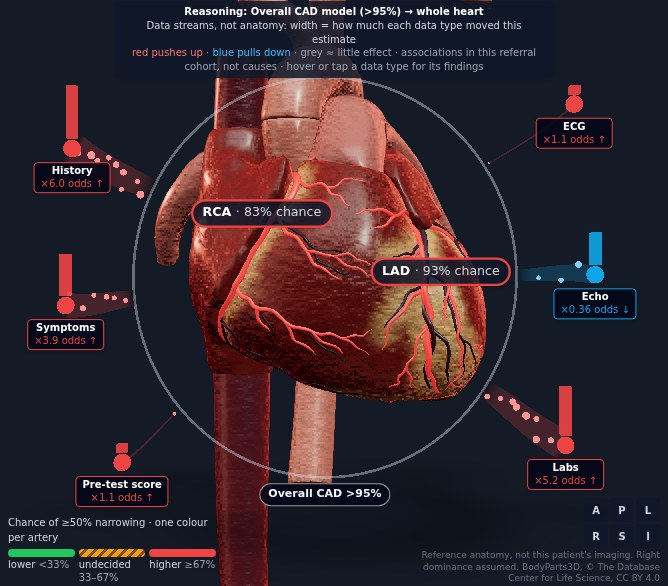
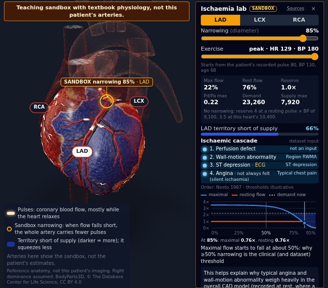
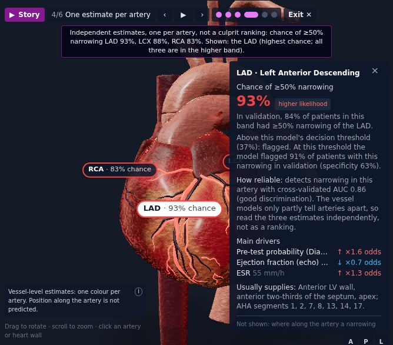

<p class="meta">Team HumanSlop: Varun Rao and Galaba Vamsi · Demo video: <a href="https://youtu.be/Gk6_mYgvZAc">youtu.be/Gk6_mYgvZAc</a> · Code, data pipeline and trained-model recipe: <a href="https://github.com/VARUN3WARE/cardiovision">github.com/VARUN3WARE/cardiovision</a> · All metrics are reproducible with <code>python backend/train.py</code> and <code>python backend/verify_models.py</code>.</p>

<p class="warn"><b>Decision support / educational use only.</b> The models were trained on 303 patients referred for angiography at one centre (71% had CAD). They are not validated for screening, are not a diagnosis, and do not replace angiography or professional judgement. The same disclaimer is permanently visible in the UI and returned in every API response.</p>

## 1. Overview

CardioVision predicts **overall coronary artery disease (CAD)** and **≥50% stenosis of the LAD, LCX and RCA** from 55 routine clinical inputs (demographics, history, symptoms, examination, ECG, laboratory, echocardiography), maps the four probabilities onto interactive 3D hearts and explains every estimate feature by feature. A clinician can enter a full record or a 19-input quick record, and estimates update live (Figure 1). A twin and simulation layer (Section 7) adds a heartbeat and ECG driven by the recorded values, the evidence flowing in by data type, a what-if, an ischaemia sandbox, similar real patients and a guided story.

<figure class="full"><figcaption><b>Figure 1.</b> The application with a real dataset patient (#173, three-vessel disease on angiography). Left: validated clinical form with quick/full modes and example patients. Centre: the BodyParts3D atlas heart in a ghosted chest after the fly-in; each coronary tree takes the band colour of its own model's estimate, and the illustrative two-lead ECG is built from the recorded findings. Right: risk estimate with its calibration band and validation AUC, per-artery cards with held-out estimates against angiography, and the AHA 17-segment bullseye.</figcaption></figure>

**Architecture** (Figure 2). A training pipeline writes four model artefacts with validation metrics and feature metadata; offline scripts verify the models, pick the example patients and build the similar-patient file. A FastAPI service validates input, fills unrecorded values, runs the four models and returns probabilities, decision thresholds, calibrated risk bands, out-of-range warnings and exact per-feature attributions (`POST /explain`: median 140 ms, 90th percentile 147 ms on a laptop CPU, measured on 10 Oct; `POST /predict`, without attributions, median 40 ms, serves the what-if sliders). The React front end renders the form, dashboard, explanations and the 3D scene (React Three Fiber). The design is extensible by construction: input fields are declared once in a pydantic schema and a front-end field specification; a new target is one entry in `TARGETS` and `make_model()`; and one artery registry (`frontend/src/anatomy/registry.ts`: model output, label, territory, AHA segments, FMA id, atlas part) drives every view, from the arteries and territories of all three hearts to the cards, bullseye, inspector, explanation tabs, reasoning streams and lab physiology, so a new artery or model output is one registry entry plus its geometry.

<figure class="full"><figcaption><b>Figure 2.</b> System architecture and data flow.</figcaption></figure>

## 2. Dataset and preprocessing

**Data.** Extension of the Z-Alizadeh Sani dataset (UCI id 411): 303 patients, 55 inputs, no missing values. Targets: `Cath` (CAD 216, 71.3%), LAD stenotic 177 (58.4%), LCX 119 (39.3%), RCA 114 (37.6%). Always predicting the majority class already scores 71.3 / 58.4 / 60.7 / 62.4% accuracy, so accuracy is always read against these baselines. **Leakage guard:** `LAD`, `LCX`, `RCA` and `Cath` are never inputs, and a test asserts that the API schema and the model's feature list map one-to-one.

**Encoding.** 21 categorical columns are label-encoded with a fixed, label-free map (Y/N → 0/1). For the models, valvular disease is re-mapped to ordinal severity and bundle-branch block one-hot encoded; `Exertional CP` is constant in the data. Right-skewed labs (TG, FBS, creatinine, ESR, BUN, WBC, platelets) are log-transformed for the linear models only.

**Clinical composite features** (stateless formulas, no labels involved, so they cannot leak): Diamond-Forrester pre-test probability (age, sex, chest-pain type), counts of classic risk factors and of ECG abnormalities, chest-pain class, any wall-motion abnormality, TG/HDL and LDL/HDL ratios, atherogenic index of plasma, age × male, CKD-EPI 2021 eGFR, neutrophil/lymphocyte ratio, and the cut-offs EF < 50%, fasting glucose ≥ 126 and systolic BP ≥ 140.

**Inputs at prediction time.** Only age and sex are required. An unrecorded finding is treated as absent and an unrecorded measurement takes the cohort median (the cohort's most common value would have assumed typical angina and hypertension, which are majority-positive in this referral cohort). Every filled field is listed in the response and greyed out in the explanations; values outside the training range are flagged.

## 3. Model architecture and validation methodology

**Protocol.** All experiments share one leakage-safe harness: stratified 5-fold cross-validation repeated 5 times. Everything learned from data (scaling, regularisation strength, calibration, decision thresholds) is re-fitted inside each training fold. Candidates are compared with *paired* AUC differences on identical folds, because split noise alone moves RCA AUC by about 0.02. Six strategies were explored (regularised linear models and SVMs; tuned XGBoost/LightGBM/CatBoost; forests with calibration; clinical feature engineering with in-fold selection; multi-task chains; ensembles), and each strategy's claims were re-run by an adversarial verifier on unseen splits with a code audit for leakage. The final choice was made on fresh split seeds (400–800) with a decision rule fixed in advance, and re-checked on seeds 900–904.

**Production models.** Each target is an equal-weight blend, in log-odds, of a regularised logistic regression on the inputs plus clinical composites and a shallow gradient-boosted tree model:

| Target | Logistic member | Tree member | Recalibration |
|---|---|---|---|
| CAD | L2, 8 core composites | LightGBM, depth-1 trees (additive model) | not needed (slope 1.13) |
| LAD, LCX | L2, core composites, Platt-calibrated | XGBoost depth 4, all composites | Platt on the blend (slope → 1.0) |
| RCA | L1, all 14 composites | LightGBM depth 2, strongly regularised | not needed (slope 0.96) |

**Decision thresholds** are learned in inner cross-validation on the training data: the F1-optimal threshold for the yes/no call, plus a rule-out (≥95% sensitivity) and a balanced threshold that define CAD's lower/intermediate/higher bands. Vessel bands use fixed 1/3 and 2/3 cut-offs. Each band reports the event rate actually observed in cross-validation.

**Explanations are exact, not approximate.** Linear members contribute coef·(x − mean); tree members use native TreeSHAP from LightGBM/XGBoost; contributions are averaged across the blend and passed through the Platt map. Hence *starting point + Σ contributions = model log-odds*, which the API checks on every request. The `shap` package is not used (its TreeExplainer is incompatible with XGBoost 3.x).

## 4. Evaluation results

| Target | ROC-AUC | PR-AUC | Brier | Accuracy | Precision | Recall | F1 | F1 at tuned threshold* |
|---|---|---|---|---|---|---|---|---|
| CAD | **0.943 ± 0.005** | 0.976 | 0.083 | 0.883 | 0.910 | 0.928 | 0.919 | 0.915 (recall 0.93) |
| LAD | **0.856 ± 0.011** | 0.883 | 0.148 | 0.799 | 0.797 | 0.880 | 0.836 | 0.839 (recall 0.91) |
| LCX | **0.761 ± 0.013** | 0.625 | 0.196 | 0.700 | 0.656 | 0.497 | 0.566 | 0.660 (recall 0.84) |
| RCA | **0.739 ± 0.006** | 0.594 | 0.199 | 0.682 | 0.596 | 0.479 | 0.530 | 0.613 (recall 0.80) |

<p class="note">5 × 5 repeated stratified CV, mean ± sd across repeats (split noise, not a confidence interval); decisions at 0.5 unless stated. *Nested: the threshold is chosen inside each training fold and applied to the held-out fold. CAD rule-out point: sensitivity 0.97, negative predictive value 0.89.</p>

<figure class="full"><figcaption><b>Figure 3.</b> Left: ROC curves from out-of-fold predictions. Right: calibration by predicted-probability decile, pooled over the five repeats; the dashed line is perfect calibration.</figcaption></figure>

**Against the starting model.** On split seeds never used for selection (900–904), paired on identical folds, the blends beat the original depth-4 XGBoost in every repeat: AUC CAD 0.900 → 0.940 (+0.040), LAD 0.828 → 0.862 (+0.034), LCX 0.745 → 0.758 (+0.014), RCA 0.678 → 0.746 (+0.068). Calibration improved more than discrimination: the original model was over-confident (calibration slopes about 0.3–0.7 on these splits, 1 = ideal), the production models score 0.85–1.11 on the fresh splits below, and Brier scores fell for every target. About half the gain comes from the model family (the original overfitted and was over-confident) and half from the clinical composites, the only change that moved LCX.

**Independent verification** (`backend/verify_models.py` → `docs/model-verification.md`). A separate script re-checks the shipped models:

| Target | AUC, fresh splits (95% CI) | Diamond-Forrester only | Logistic regression, raw inputs | Default XGBoost | Calibration slope | AUC within CAD patients |
|---|---|---|---|---|---|---|
| CAD | **0.939** (0.91–0.97) | 0.822 | 0.915 | 0.899 | 1.11 | – |
| LAD | **0.859** (0.82–0.91) | 0.760 | 0.810 | 0.816 | 0.92 | 0.69 |
| LCX | **0.745** (0.71–0.81) | 0.707 | 0.664 | 0.735 | 0.85 | 0.63 |
| RCA | **0.754** (0.70–0.81) | 0.689 | 0.723 | 0.691 | 1.03 | 0.62 |

<p class="note">Split seeds 5000–5004, never used in development; 95% CI by bootstrap. Baselines on the same folds: the production models beat plain logistic regression in 5 of 5 repeats for every target, and default XGBoost in 5 of 5 (LCX 4 of 5).</p>

*Leakage:* no target column is an input, and the full recipe trained on shuffled labels scores AUC 0.48–0.52. *Reproduction:* fresh-split AUCs agree with those from `train.py` within split noise (LCX and RCA move about ±0.02 between split sets); because the recipe was chosen on these 303 patients, expect true AUCs about 0.005–0.01 lower (0.01–0.02 for RCA). The served models equal a fresh refit, and the live API returned exactly their predictions for 40 random patients. *Vessel specificity:* the CAD model's own estimate predicts the LAD label as well as the LAD model does (AUC 0.86 vs 0.86); within CAD patients the vessel AUCs fall to 0.62–0.69, and in the 87 single-vessel patients the highest vessel estimate names the diseased artery 61% of the time, against 66% for always guessing LAD (isolated RCA disease ranked first in 0 of 17). The vessel models therefore mostly measure how much disease there is, so the UI shows three independent per-artery estimates and never a culprit vessel. *Clinical direction:* changing one finding for every patient moves the CAD estimate the textbook way in 12 of 16 checks (typical angina +28.9 points). The four exceptions are associations of this referral cohort, not causes: CAD was as common at high as at low LDL (73% / 68% / 73% across three bands), weakly and non-monotonically related to HDL, more common in lighter patients (76% below 65 kg, 68% above 80 kg), and more common with no chest pain recorded than with atypical pain (63% vs 43%). The what-if card therefore locks LDL, HDL and weight.

**Against the literature.** Published accuracies on this dataset reach 83–98%, mostly from protocols that select features or resample on all 303 patients before cross-validation, or report a single small test set. Protocol-clean studies agree with our numbers: logistic regression under 10-fold CV reaches CAD AUC 0.932 and accuracy 0.90 [3]; early 10-fold per-vessel work reports accuracies of LAD 74–80%, LCX 59–65% and RCA 66–69% [2]; a simple held-out baseline reaches AUC 0.79 / 0.79 / 0.73 [4]. **Quick mode** (19 inputs, the rest defaulted), measured on held-out folds: CAD AUC 0.935 → 0.937, LAD 0.859 → 0.846, LCX 0.774 → 0.756, RCA 0.744 → 0.728.

## 5. 3D pipeline

**Rendering stack.** React Three Fiber (three.js r169) with drei and post-processing (ambient occlusion, bloom on the selected vessel, ACES tone mapping). On a laptop's integrated Intel GPU a full frame with post-processing takes a median 11–14 ms on every heart, 18 ms at most (measured before the twin layer was added); an *HD* switch turns post-processing off, and HD switches itself off below about 24 fps. Without WebGL the app shows a 2D fallback and everything else keeps working.

**Three hearts.** The default is the open-licence sculpted model *Realistic Human Heart* (neshallads, CC BY 4.0; 22.6k triangles, WebP textures, 1.6 MB). The **atlas heart** is built from BodyParts3D, the anatomy database named in the brief: a build script range-fetches only the 181 meshes it needs from the official archive (CRC-checked), converts, simplifies and compresses them into a heart (72.5k triangles, 0.39 MB) and a chest (skin, ribs, sternum, spine, diaphragm, trachea; 74.3k triangles, 0.35 MB). Its 59 named coronary branches keep their FMA ids and each takes its colour from exactly one model output; the left main stays neutral because the dataset does not label it. The heart opens inside a ghosted chest with a camera fly-in; a camera-facing cutaway keeps it visible through the chest wall, an X-ray mode shows the vessels behind, and buttons snap to the standard views. A procedural *schematic* heart is a toggle and the fallback if a model file fails to load.

**Coronary tree fitted to the realistic model.** That model's coronaries are only sculpted grooves. We traced the left main, LAD with two diagonals, LCX with two obtuse marginals, and RCA with an RV branch and the posterior descending artery along them; at load time each path is resampled, snapped onto the surface with a BVH closest-point query (three-mesh-bvh), lifted along the normal, smoothed and rendered as a tapered tube bound to exactly one model output.

**Territories and encoding.** Every ventricular vertex gets soft weights to the LAD, LCX and RCA trees from its distance to each tree (masked below the atrioventricular groove; on the atlas heart the distances are baked into the mesh). One band colour scale (lower < 33%, undecided 33–67% with stripes, higher ≥ 67%; CAD bands from its learned thresholds) colours the arteries, *Territories* mode, cards and legend alike (Figure 4, left); labels read "LAD · 93% chance", and the last estimate stays on screen while the user types.

**Interaction.** Selecting an artery, its label or the heart wall (which selects the artery that perfuses it) swings the camera to that territory, highlights it (Figure 4, right), switches the explanation panel to that model and opens a **vessel inspector**: band, the rate observed in validation, the decision threshold with its measured sensitivity and specificity, AUC, top drivers, the territory with its AHA segments, and what the view does not show. An AHA 17-segment bullseye in the dashboard is linked to the 3D heart.

<figure class="pair"><figcaption><b>Figure 4.</b> Realistic heart, isolated-LAD patient (#171). Left: perfusion-territory mode (LAD territory 92%, RCA 30%, LCX 19%). Right: RCA selected; the camera turns to the inferior wall, and the RCA and posterior descending artery glow with their territory highlighted.</figcaption></figure>

## 6. Clinical dashboard and interpretability

<figure class="right"><figcaption><b>Figure 5.</b> LAD explanation for the isolated-LAD patient: summary sentence, top drivers with odds multipliers, and the path from the model's starting point to the estimate.</figcaption></figure>

**Risk estimate.** The CAD probability and the three vessel probabilities are shown as whole percentages with a likelihood band and the event rate observed in validation for that band (e.g. "93% of patients in this band had CAD on angiography"). Each model's cross-validated AUC is shown, weaker vessel models (AUC < 0.75) are marked as indicative, and disagreement between the CAD and vessel models is flagged.

**Why this estimate?** Per model, the panel gives a one-sentence explanation, the top drivers as diverging bars with a strength word and odds multiplier, and a waterfall in percentage points from the model's starting point to the patient's estimate (Figure 5). Derived clinical scores are labelled and list their inputs. An "Evidence by data type" strip gives the same sums as the reasoning streams (Section 7), and a **physiological breakdown** lists all 55 measurements plus the derived scores by body system, each with the patient's value and its contribution.

**Honest examples.** Five real dataset patients (normal, isolated LAD, isolated RCA, three-vessel disease and an uncertain case) load with one click, shown with their angiography result and a *held-out* estimate from models that never saw them, including the model's own misses and false alarms.

**Usability.** Inputs come with units and plausible ranges and are validated as you type; chest pain and smoking are single choices; BMI is calculated; API errors are mapped to the offending field; stale results are marked whenever the inputs change.

## 7. Twin and simulation layer

Each layer says what it is: reference anatomy, not the patient's imaging; recorded values; associations, not causes; model sensitivity, not treatment effect; a sandbox, not the patient's arteries.

**Function twin and ECG.** One heart clock (500 Hz ticks) drives all three hearts from the patient's recorded values as the model saw them: the pulse sets the rate, ejection fraction the squeeze and systolic BP the aortic pulse, and left bundle branch block makes the lateral wall contract late. Beat timing uses PR 0.16 s, QRS 0.09 s (0.14 s in bundle-branch block) and Bazett's QT. A sweeping two-lead monitor (II, V1) draws a sum-of-Gaussians waveform in the manner of McSharry et al. [7] with the recorded ST and T-wave changes, Q waves, LVH, poor R-wave progression and bundle-branch block, captioned as illustrative, not the patient's tracing.

**Reasoning flow** (Figure 6, left). Each model's exact attributions are summed into six data types: history and demographics, symptoms and examination, ECG, echo, labs, and the pre-test score (each derived composite goes to one group by a stated rule). The base value plus the group sums equals the model's log-odds exactly, which unit tests check for every example patient and model. Instanced particle streams run from towers placed around the heart, never on it, into the selected artery's label, or into a halo round the whole heart for overall CAD; width is the size of the effect, red raises and blue lowers the estimate.

**What-if.** Sliders for systolic BP, fasting glucose and triglycerides (cohort 5th–95th percentiles), a quit-smoking switch and "flip one recorded finding" switches (typical angina, ST depression, wall motion, EF) re-run all four models on a copy of the submitted record: `POST /predict` at most every 120 ms with one request in flight while a slider moves, then one `/explain` on release. The form is never edited, the twin keeps the recorded values, and every view labels the result as model sensitivity, not the effect of treatment. LDL, HDL and weight are locked (Section 4).

**Ischaemia lab** (Figure 6, centre). A labelled teaching sandbox on one generic narrowing chosen by the user, never the patient's lesion: the risk colours give way to the sandbox and a banner says "textbook physiology, not this patient's arteries". The model (`twin/coronaryPhysiology.ts`) combines Gould's stenosis pressure drop ΔP = F·Q + S·Q² (viscous and separation terms) [5] with one microvascular resistance, autoregulation (flow = min(demand, maximal flow)), a normal flow reserve of 4 and demand from the rate-pressure product; exercise raises the heart rate to 85% of (220 − age) and systolic BP by 50 mmHg (at most 210), starting from the recorded pulse, BP and age. Its unit tests reproduce the published curve: maximal flow first falls below 95% at 50.5% diameter narrowing while resting flow holds to about 84% at the reference resting demand (pulse × BP 9,100; higher resting demand lowers it), which is why ≥50% is the clinical and dataset threshold. Flow pulses are a shader stripe along each artery's distance from its ostium, mostly in diastole; the territory darkens and contracts less as supply falls short; and the ischaemic cascade (perfusion defect, wall-motion abnormality, ST depression, angina) lights in the order of Nesto and Kowalchuk [6] beside the dataset inputs it corresponds to (thresholds illustrative).

**Similar patients.** An offline script z-scores the 55 encoded inputs, weights each by the CAD model's mean |attribution| and writes a static file with a 3D t-SNE map of the 303 patients (trustworthiness 0.974, against 0.901 for PCA). The browser finds the 10 nearest patients with the script's exact arithmetic (no mismatch in 703 test queries), leaves inputs that were not entered out of the distance, and recognises a dataset patient (same values on every compared input, or up to three changed, with enough specific agreement), who is then left out of their own neighbours. Neighbours are listed with their held-out estimates against their angiograms; "no close matches" appears when the 10th neighbour is farther than for 95% of dataset patients.

**Story mode** (Figure 6, right). The **▶ Story** button plays six captioned steps on the atlas heart, 92 s in all: the chest fly-in; the function twin; the reasoning streams for overall CAD; the artery in the highest band (ties: highest chance) with its inspector, captioned "independent, not a culprit ranking"; the lab sandbox, a generic narrowing of that artery growing 0 → 85%, then exercise rest → peak; and a closing card (reference anatomy, the 303-patient referral cohort, cross-validated AUCs with bootstrap 95% CIs, decision support only). Captions use only the patient's result and recorded values, the lab model, `/metrics` and the verification. Play/pause, previous/next, arrow keys and Esc control it; exit restores the user's exact view (heart, modes, lab settings, selection, camera) without touching the record or a what-if scenario, and with reduced motion the steps are static.

<figure class="pair" style="grid-template-columns: repeat(3, 1fr)"><figcaption><b>Figure 6.</b> Twin layer on the atlas heart, patient #173. Left: reasoning flow for overall CAD; six data-type streams end on a halo round the heart (history ×6.0 and labs ×5.2 raise the odds, echo ×0.36 lowers them). Centre: ischaemia lab, a sandbox LAD narrowing of 85% at peak exercise (heart rate 129, BP 180, from her recorded 80 and 130): maximal flow 22% of normal, 66% of the territory's demand unmet, the full cascade lit. Right: story step 4 of 6, the inspector on the LAD (highest chance; all three arteries are in the higher band).</figcaption></figure>

## 8. Usage and tests

```bash
# backend (Python 3.10–3.13)
cd backend && python -m venv .venv && source .venv/bin/activate
pip install -r requirements.txt
python train.py          # ~4-5 min: 5x5 CV, thresholds, writes models/
python make_cohort.py    # similar-patient file (deterministic)
python test_pipeline.py  # end-to-end checks without a server
python verify_models.py  # independent verification -> docs/model-verification.md
uvicorn app.main:app --port 8000          # API docs at /docs
# frontend (Node 18+)
cd frontend && npm install && npm run dev  # http://localhost:5173
npm test                                   # unit tests (vitest)
```

The dataset ships with the repository as the UCI zip and is extracted on first training. API: `POST /explain` (probabilities, thresholds, bands, warnings, filled fields and attributions), `POST /predict`, `GET /metrics`, `/features`, `/health`. Deep links open any view: `?patient=low|lad|rca|triple|uncertain`, `?heart=realistic|atlas|schematic`, `?reasoning=1`, `?whatif=1`, `?lab=lad&narrowing=85&exercise=1`, `?cohort=1`, `?story=1&step=4`. Tests: `test_pipeline.py` (schema and features map one-to-one, exact attributions for every preset, quick mode, warnings) and 111 vitest unit tests (twin, physiology, lab, data-type sums, what-if, nearest neighbours, story). The experiments are reproducible with `backend/experiments/exp_*.py`; `HARNESS_SEED_OFFSET=900 python experiments/exp_final_recipe.py eval` repeats the final check on fresh splits.

## 9. Limitations and credits

**Limitations.** A single centre and 303 referred patients (71% with CAD), with no external validation: bootstrap 95% intervals are CAD 0.91–0.97, LAD 0.82–0.91, LCX 0.71–0.81 and RCA 0.70–0.81, and the models are not validated for screening. LCX and RCA remain hard targets (AUC 0.74–0.76). The vessel models mostly measure how much disease there is, not which artery (Section 4), and the four models are independent and can disagree. Attributions are associations in a referral cohort, not causes. The anatomy is a reference: the realistic tree is traced on one sculpted heart and the atlas is one right-dominant BodyParts3D heart, never the patient's imaging, and findings are model inputs, never places on the heart. The twin drives that reference heart with recorded values, the lab is textbook physiology, and frame times predate the twin layer.

**Credits and references.** [1] Z. Alizadeh Sani et al., Extension of Z-Alizadeh Sani dataset, UCI Machine Learning Repository (id 411). [2] R. Alizadehsani et al., Diagnosis of coronary arteries stenosis using data mining, J Med Signals Sens 2012;2(3):153-159, doi:10.4103/2228-7477.112099; and Diagnosing coronary artery disease via data mining algorithms by considering laboratory and echocardiography features, Res Cardiovasc Med 2013;2(3):133-139, doi:10.5812/cardiovascmed.10888. [3] M. Zhang, H. Wang, J. Zhao, Use machine learning models to identify and assess risk factors for coronary artery disease, PLoS One 2024;19(9):e0307952, doi:10.1371/journal.pone.0307952. [4] Z. Jin, N. Li, Diagnosis of each main coronary artery stenosis based on whale optimization algorithm and stacking model, Math Biosci Eng 2022;19(5):4568-4591, doi:10.3934/mbe.2022211. [5] K.L. Gould, K. Lipscomb, G.W. Hamilton, Physiologic basis for assessing critical coronary stenosis, Am J Cardiol 1974;33:87-94; K.L. Gould, Cleve Clin Q 1980;47:140. [6] R.W. Nesto, G.J. Kowalchuk, The ischemic cascade, Am J Cardiol 1987;59:23C-30C. [7] P.E. McSharry et al., A dynamical model for generating synthetic electrocardiogram signals, IEEE Trans Biomed Eng 2003;50:289-294. Further physiology sources are cited in the code and the lab's Sources list. 3D models: "Realistic Human Heart" by neshallads (Sketchfab), CC BY 4.0; BodyParts3D, © The Database Center for Life Science, CC BY 4.0 (derived files CC BY-SA 4.0). Built with FastAPI, scikit-learn, XGBoost, LightGBM, React, three.js / React Three Fiber, drei and three-mesh-bvh.
